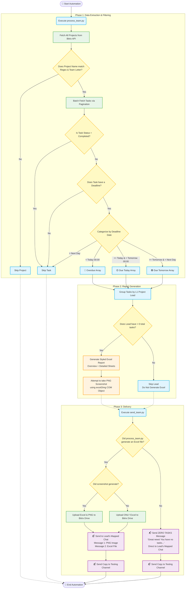

# Project Visual Flowchart (Detailed End-to-End Logic)

This flowchart visualizes the complete step-by-step logic of the automation, including the newly added logic for sending congratulatory messages when a team member has zero active overdue tasks.

