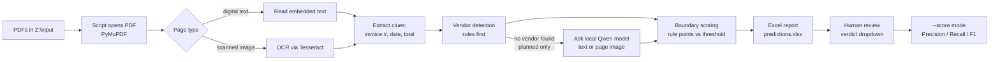

# Project Overview — Invoice Boundary Detection Engine

**A plain-English reference for Team D (Puneet, Dhruv, Manish, Vijayesh)**

This document explains, in non-technical language, what this project does, how it works end to end, and where things currently stand. It is meant to be the one place a CPA/CA on the team can read to understand and maintain this project long after the person who built it has moved on. Wherever a technical term or Python library shows up, it is explained in plain English on first use, and there's a glossary at the bottom.

This file does not modify or replace any other file in the project — it is a companion reference, generated by reading the project's own code, notes, and handoff files.

---

## Table of contents

1. [Purpose & who this is for](#1-purpose--who-this-is-for)
2. [Architecture / system flow](#2-architecture--system-flow)
3. [The script in detail](#3-the-script-in-detail)
4. [The Excel report format](#4-the-excel-report-format)
5. [Configuration (`config.json`)](#5-configuration-configjson)
6. [Rules & checkpoints the script follows / must follow](#6-rules--checkpoints-the-script-follows--must-follow)
7. [Current status & what's pending](#7-current-status--whats-pending)
8. [Verification](#8-verification)
9. [Glossary](#9-glossary)

---

## 1. Purpose & who this is for

Vendors sometimes send **one PDF that actually contains several separate invoices stapled together** — for example, a single PDF from a repeated vendor (like Staples or Ferguson) that bundles multiple invoices, or a batch scan where several unrelated bills got combined by mistake. Before the accounting team can correctly code, pay, or reconcile these documents, someone needs to know:

- **Where does each individual invoice actually start** inside the combined PDF (which page)?
- **Who is the vendor** on each invoice?

Doing this by hand — opening every PDF and reading every page — is slow and repetitive, exactly the kind of task this automation exists to speed up, in support of the team's **monthly close** work (bank reconciliation, AR/AP aging, GL coding, and cross-checking automation output against the real thing).

**This tool never splits, edits, renames, or deletes the original PDFs.** It only *reads* them and *predicts* — page by page — where a new invoice probably begins and who the vendor probably is. Those predictions go into an Excel file that a human reviews and corrects. Actual PDF-splitting is intentionally a **future, separate project**, to be built only after the prediction accuracy is proven good enough (see [Section 8](#8-verification)).

This document — and the project itself — is written for **Team D, who are not engineers.** Every technical concept below is explained in plain English before any jargon is used.

---

## 2. Architecture / system flow

### The two-machine setup

The project runs across two machines on the office network:

| Machine | What it does |
|---|---|
| **Windows PC(s)** — 1 to 3 of them, one per team member who needs to run the tool | Installs Python, Tesseract (the OCR/text-reading tool), and a copy of `invoice_boundary_detector.py`. This is the machine that actually **runs the script**. |
| **The host/server machine that shares the folder and serves the local Qwen model** | Does two jobs only: (1) shares a folder over the office network (using built-in file-sharing — no extra software), which Windows maps as a drive letter, `Z:`; and (2) runs a **local AI model** (Qwen, via free software called Ollama) that Windows PCs can call over the network to help identify vendors that plain text-matching misses. |

**Why a local AI model, and why it matters for privacy:** invoices contain client financial data. The AI model (Qwen) runs entirely on the office's own host/server machine — it is never sent to any cloud AI service, and it needs no account, login, or API key. Anything that asks for a "Qwen API key" is the paid cloud version and must **not** be used for this project, because it would send client data off-site. If any future design change would send an invoice or its data to a cloud service, that should be flagged loudly and stopped.

The shared folder is mapped on each Windows PC as drive **`Z:`**, so from the script's point of view, reading and writing files on `Z:\input`, `Z:\output\reports`, etc. behaves just like a local folder — but the actual files live on the host/server machine.

### Data flow, in plain English

1. Someone drops PDF files into `Z:\input` (or, on a single-PC test setup, a local `input/` folder next to the script).
2. The script (running on the Windows PC) opens each PDF and reads every page's text.
3. It pulls out useful clues from each page — invoice number, date, total, vendor name, etc.
4. It compares each page to the page before it, using a set of independent "rules," to decide: does this page **continue** the previous invoice, or does a **new invoice start here**?
5. It figures out who the vendor is for each page (today: pattern-matching rules; in the future, once built: escalating to the local AI model when rules can't tell).
6. It writes all of this into an Excel report (`predictions.xlsx`) that a human reviews.
7. A reviewer marks each row "Correct / Partially correct / Incorrect / Needs a closer look," and — for anything wrong — types in the real split pages.
8. The script can then be run in `--score` mode to read the reviewer's corrections back and calculate how accurate the predictions were (Precision / Recall / F1 — explained in the [glossary](#9-glossary)).

### Diagram — the data path

```
WINDOWS PC (runs the script)                    HOST/SERVER MACHINE
-----------------------------                   (file share + local Qwen AI)
                                                  ------------------------------
Z:\input\  <───────── shared folder ─────────>   input/  (PDFs land here)

  1. Script opens each PDF (PyMuPDF)
  2. Reads page text
        - today:      every page is OCR'd (Tesseract), even digital ones
        - planned:    digital pages read directly (fast, accurate);
                       only scanned/image pages go through OCR
  3. Pulls out clues: invoice #, date, total, vendor (regex pattern-matching)
  4. Vendor detection:
        - today:      rule-based only (known list -> page-top text ->
                       email domain -> "From:/Vendor:" label)
        - planned:    if rules find nothing, ask the local AI model
                       over the network  ───────────────────────────►  Qwen model
                                                                        (text or single
                                                                         page-image only —
                                                                         never the PDF file)
  5. Boundary scoring: each rule adds/subtracts points; if the total
     reaches the threshold, "a new invoice starts here"
  6. Builds the Excel report
                                                  Z:\output\reports\
Z:\output\reports\predictions.xlsx <───────────>  predictions.xlsx  (report lives here)

  7. Human reviewer opens predictions.xlsx, marks each row's verdict
  8. python invoice_boundary_detector.py --score
     grades predictions against the reviewer's corrections
```



**Important distinction to keep in mind while reading this document:** the "digital text first, OCR only for scanned pages" step and the "ask the local AI model" step are the **planned next phase of work (called Deliverable B)** — they are **not built yet**. The script that exists and runs today OCRs *every* page uniformly and only ever uses rule-based vendor detection. Section 7 spells out exactly what's built versus planned.

---

## 3. The script in detail

Everything lives in **one file**, `invoice_boundary_detector.py`, deliberately organized into clearly labeled sections with plain-English comment blocks — so the whole project stays something a non-engineer can open, read top to bottom, and maintain. There is intentionally **no separate settings file logic buried in code** — every tunable number lives in `config.json` (see [Section 5](#5-configuration-configjson)).

### Libraries used, and why

| Library | Plain-English purpose |
|---|---|
| **PyMuPDF** (imported in code as `fitz`) | Opens PDF files and can turn each page into a picture (an "image"), and can also pull out a page's real embedded text directly, without needing OCR, when the PDF has real digital text. |
| **pytesseract** | Sends a page image to **Tesseract** (a free, separately-installed program) and gets back the text Tesseract can read off the image — this is OCR (Optical Character Recognition). |
| **Pillow** (imported as `PIL`) | Handles the picture of the page in memory as it passes from PyMuPDF to pytesseract. |
| **openpyxl** | Builds and reads the `.xlsx` Excel report — including the colored headers, the reviewer-verdict dropdown menu, and later reading the reviewer's filled-in answers back in for scoring. |
| **tqdm** *(optional)* | Shows a small progress bar in the terminal while many PDFs are processed. If it isn't installed, the script still works fine — just without the progress bar (there's a small fallback built in for this). |
| `json`, `re`, `pathlib`, `sys`, `argparse`, `logging`, `datetime` *(all built into Python — nothing extra to install)* | `json` reads `config.json`. `re` does pattern-matching ("regular expressions") to find things like invoice numbers inside blocks of text. `pathlib` handles file paths in a way that works the same on Windows and Mac. `argparse` reads the command-line flags like `--score`. |
| **stdlib `urllib.request`** *(planned, not yet used)* | The future Qwen/AI calls are planned to use Python's own built-in web-request tool — no new library needs to be installed for that. |

### Section-by-section walkthrough

The script's own comments label these sections (numbered 1–10, with SELFTEST as its own block); here's what each one does.

**Section 1 — CONFIG.** `load_config()` reads `config.json` (the one settings file) and hands back a dictionary of everything the rest of the script needs: folder paths, the Tesseract program location, OCR image quality, the scoring threshold, rule point-values, and the known-vendor list. The idea: numbers you might want to tune live in the config file, not hidden inside code.

**Section 2 — READER (OCR).** `collect_pdfs()` lists every `.pdf` file directly inside the input folder (sorted, so runs are repeatable). `read_pdf_pages()` opens one PDF with PyMuPDF and, for **every page**, renders it as a 300-dots-per-inch image and runs Tesseract OCR on that image to get the text — even for pages that already have real, embedded digital text. This uniform approach was a deliberate early design choice for consistency. If a page (or the whole file) can't be read, the script does **not** silently skip it — it records the failure reason so a reviewer can see why later.

**Section 3 — FEATURES.** `extract_features()` takes one page's text and uses pattern-matching (`re`, regular expressions — think "find text that looks like a date" or "find text that looks like a dollar amount") to pull out: invoice number, invoice date, due date, total amount, PO number, "bill to" line, and currency. Anything not found comes back empty (`None`) rather than guessed.

**Section 4 — VENDOR.** `detect_vendor()` figures out who the invoice is from, trying four methods in order from most to least reliable:
1. **Known-vendor list** (from `config.json`) — if any name on that list appears anywhere in the page text, it's used immediately, with **high** confidence.
2. **Top-of-page company line** — looks at the first ~8 non-blank lines of the page for a business name ending in a legal suffix like LLC, Inc, Co, Supply, Services, Plumbing, Electric. **Medium** confidence.
3. **Email/website domain** — looks for something like `billing@acmeplumbing.com` and uses `acmeplumbing`. **Medium** confidence.
4. **"From:"/"Vendor:"/"Remit to:" label** — last-resort pattern match on an explicit label. **Low** confidence (this is the layer most likely to grab garbage text, e.g. a stray sentence, if nothing better is on the page).

If none of the four find anything, the vendor is recorded as **not found** rather than guessed — the script never silently fabricates a vendor name.

**Section 5 — RULES.** Five small, independent checks compare the current page to the one before it. Each rule either fires (returns points and a plain-English reason) or stays silent:

| Rule | What it checks | Default points | Pushes toward |
|---|---|---|---|
| `rule_invoice_number_changed` | The invoice number on this page is different from the previous page's | **+100** | New invoice (Break) |
| `rule_vendor_changed` | The detected vendor changed from the previous page | **+40** | New invoice (Break) |
| `rule_invoice_header_detected` | This page's text contains header-style keywords ("invoice," "statement," "bill to," "remit to," "invoice date") | **+30** | New invoice (Break) |
| `rule_same_vendor` | The vendor is the same as the previous page | **−20** | Same invoice (Continue) |
| `rule_continuation_pattern` | The page says things like "continued," "page 2 of 3," "carried forward" — or has neither an invoice number nor header keywords at all | **−40** | Same invoice (Continue) |

**Section 6 — CONFIDENCE.** `score_boundary()` adds up whichever rules fired for a page. If the total reaches the **`break_at_score`** threshold in `config.json` (default **50**), the script decides "**Break**" — a new invoice starts on this page. Otherwise it decides "**Continue**." How far the total is from the threshold line becomes a rough confidence label (high / medium / low). The very first page of every PDF is always automatically marked "Break," since a PDF obviously starts with *some* invoice.

**Pipeline glue** (`build_pages`, `summarize_pdf`) turns the raw per-page OCR results into fully "enriched" pages (features + vendor attached), runs the boundary predictions across the whole PDF, and rolls everything up into one summary per PDF: how many pages, how many invoices were found, which pages they start on, and which vendor(s) appear.

**Section 7 — PROPOSED NAME.** `assign_proposed_name()` works out what a single-vendor PDF *would* be renamed to, and writes that as plain **text** into the Excel report — it does **not** actually rename or copy any file (an earlier version of the script did copy-and-rename real files; that behavior was deliberately removed). If a PDF contains only one vendor, the proposed name is `VendorName.pdf` (with `_01`, `_02`, … added if that same vendor's name repeats across the batch). If a PDF mixes multiple vendors, the note is `(mixed vendors)`; if no vendor was found at all, it's `(no vendor detected)`.

**Section 8 — REPORT.** `build_excel_report()` writes the Excel file reviewers actually use — see full column layout in [Section 4](#4-the-excel-report-format).

**Section 9 — SCORER.** `score_reviewed_report()` — this is what runs when you use `--score`. It reads the reviewer-filled Excel back in and computes accuracy numbers: how many of the predicted "new invoice starts here" pages were actually right (Precision), how many of the real split points the script actually caught (Recall), and a single combined score (F1). Rows the reviewer left blank (not yet reviewed) are skipped rather than counted as wrong — this was a real bug that got found and fixed early on (see [Section 7](#7-current-status--whats-pending)).

**SELFTEST.** A set of 15 small built-in checks (`_check_...` functions, collected in the `SELFTESTS` list) that prove the important logic still works: config loads correctly, PDF collection is sorted, regex patterns for invoice number/date/total work, each vendor-detection layer works, filename sanitizing works, the boundary rules fire correctly in both directions, the first page always breaks, PDF summaries count splits correctly, vendor-name deduplication works, page-number parsing works, the Precision/Recall/F1 math is correct, and — importantly — that unreviewed (blank-verdict) rows are skipped rather than scored as wrong. Run any time with `--selftest`; needs no PDFs, no network, and no Tesseract to pass.

**Section 10 — MAIN.** The command-line front door (`argparse`). Reads the flag you passed and dispatches to the right mode:

| Command | What happens |
|---|---|
| `python invoice_boundary_detector.py` | Default mode: reads every PDF in the input folder, predicts boundaries and vendors, writes `predictions.xlsx`. |
| `python invoice_boundary_detector.py --score` | Reads a reviewer-filled `predictions.xlsx` back in and prints Precision / Recall / F1. |
| `python invoice_boundary_detector.py --selftest` | Runs the 15 built-in logic checks and prints PASS/FAIL for each. |

---

## 4. The Excel report format

`predictions.xlsx` (written to `Z:\output\reports\`, or a local `output/reports/` folder in a single-PC test) has two auto-generated tabs, plus a third tab the reviewer added by hand.

### Summary sheet — the one used day-to-day

One row per PDF file, 8 columns:

| Col | Header | What it shows |
|---|---|---|
| **A** | PDF Original Name | The real file name — **never changed**. |
| **B** | Proposed PDF Name | What the file *would* be renamed to if it were a single-vendor PDF (text only — no file is actually renamed or copied). |
| **C** | Pages | Total page count. |
| **D** | New invoice starts at | The predicted split points, e.g. `p1, p6, p9` (for mixed-vendor PDFs, the vendor is shown at each point too). |
| **E** | # invoices | How many invoices the script thinks are in this PDF. |
| **F** | Vendors | The distinct vendor(s) detected. |
| **G** | Reviewer verdict | A **dropdown** with exactly four choices: ✅ Correct / ⚠️ Partially correct / ❌ Incorrect / 🔍 Needs a closer look. |
| **H** | Correct split pages (if wrong) | Where the reviewer types the *real* starting pages (e.g. `1, 6, 9`) — only needed when the verdict isn't ✅ Correct. |

**`--score` reads columns D, G, and H** — it needs the prediction (D), the verdict (G), and, when the verdict says something was wrong, the reviewer's correction (H) to compute real accuracy.

### Page Detail sheet — the "why" tab

One row per page, for anyone who wants to see the reasoning: PDF name, page number, Break/Continue decision, confidence, numeric score, a plain-English list of which rules fired and their point values (e.g. `Invoice number changed (+100); Same vendor as previous page (-20)`), and any read issue. Rows where the script called "Break" are shaded light green so they stand out at a glance.

### "Proposed Summary Sheet" — the reviewer's own tab

A tab the reviewer added manually. The report-writing code is specifically written to **open the existing `predictions.xlsx`** (rather than overwrite the whole file) so this tab, and any other manually-added tabs, survive every re-run untouched. Only the `Summary` and `Page Detail` tabs get deleted and rebuilt each time the script runs.

### Pending proposal — Part C (not yet approved, not yet built)

As the project moves toward using the local AI model and processing PDFs in repeated batches, there's an open, **not-yet-approved** design proposal to extend the Summary sheet with:
- A **Vendor-source** column (did the vendor come from the rule-based list, or from the AI model's text or vision reading?).
- A **Page-type** column (was this page's text read digitally, or via OCR?).
- A **Batch** column, so the Excel can safely **accumulate** rows across multiple runs (append new batches) instead of being fully rebuilt and losing prior reviewer verdicts.

This proposal must be shown to and approved by Team D **before** any of the AI-integration code is written — it's an explicit checkpoint, not a formality.

---

## 5. Configuration

This section describes `config.json`'s structure **without opening or reading the actual file** — everything below comes from the setup guide, the project's `README.md`, and handoff notes, plus what the script's own code says it expects to find. `config.json` is intentionally the **one** place non-engineers tune behavior — no code edits needed for any of this.

| Key | Purpose |
|---|---|
| `paths` | Where files live: an **input** folder path (PDFs to process) and an **output reports** folder path (where `predictions.xlsx` gets written/read). Once the AI-integration work (Deliverable B) is built, a third **processed** folder path is planned, for PDFs that have already been successfully run through the pipeline. |
| `tesseract_cmd` | The full file path to the installed Tesseract program on **this** PC (e.g. `C:\Program Files\Tesseract-OCR\tesseract.exe`). If Tesseract is ever reinstalled somewhere else, this one line needs updating. |
| `ocr.dpi` | The image quality (dots per inch) used when turning a PDF page into a picture for OCR. Higher = sharper/more accurate but slower. Documented default: 300. |
| `thresholds.break_at_score` | The point total needed before the script calls a page "a new invoice starts here." Raise it to be more conservative (fewer, more confident splits); lower it to catch more possible splits at the risk of more false alarms. Documented default: 50. |
| `rule_weights` | The point value of each of the 5 boundary rules — see the table in [Section 3](#3-the-script-in-detail). Tuning these changes how aggressively the tool calls a new invoice. |
| `known_vendors` | A plain list of vendor names the team already knows about. Any name on this list is recognized instantly and reliably (the most trustworthy detection layer). As reviewers spot vendors the tool missed or is unsure about, adding them here is the single biggest lever for improving vendor accuracy. |
| `llm` *(planned — not read by the script yet)* | The settings block that will control the local AI model once Deliverable B is built: `enabled` (on/off switch), `host` (the network address of the local Qwen server, defaulting to `http://localhost:11434` if not set), `text_model` / `vision_model` (both expected to be exactly `qwen2.5vl:7b` — the `:7b` tag matters), `min_text_chars` (how much real text a page needs before it's treated as "digital" rather than routed to OCR/vision), `image_dpi` (image quality for the page sent to the AI model when using vision), `timeout_seconds` (how long to wait for an AI reply before giving up), and `escalate_to_vision` (whether to retry a page with the vision model if the text model can't find a vendor). |

**A note worth double-checking:** the setup guide's example `config.json` labels the output-folder key as `output_folder`, but the script's own code (`invoice_boundary_detector.py`) currently reads that same setting under the key name **`output_reports`** (both for writing the report and for finding it again under `--score`). If a run ever fails immediately with a "key not found" style error mentioning `paths`, this naming mismatch between the guide's example and what the code actually expects is the first thing to check — whoever maintains `config.json` should confirm which exact key name is present.

**Reminder — `config.json` itself was intentionally not opened while writing this document,** per an access restriction on that specific file. Everything above is a description of its expected *shape*, not its real values.

---

## 6. Rules & checkpoints the script follows / must follow

Collected from `CLAUDE.md` and every handoff note into one list — these are the hard constraints that any future work on this project (by Claude or anyone else) must keep honoring:

- **Never modify, split, rename, or overwrite original PDFs.** The script only ever *reads* PDFs. Where "archiving" processed files is planned, it will only ever **relocate** a file (a plain move), never edit, rename, or overwrite it.
- **No renamed PDF copies exist today.** An earlier version of the script copied and renamed single-vendor PDFs into an `output/renamed/` folder; that behavior was deliberately removed. Column B of the Excel ("Proposed PDF Name") is text only.
- **The Excel report builder must open the existing `predictions.xlsx`**, not overwrite the whole file — this is what preserves any manually-added tabs (like "Proposed Summary Sheet") across runs. Only the `Summary` and `Page Detail` tabs get regenerated.
- **The reviewer-verdict dropdown lives on column G**, and `--score` reads columns **D** (predicted), **G** (verdict), and **H** (correction). Any future Excel-format change must keep these working, or update `--score` to match.
- **The script must stay offline-safe.** With the local AI model disabled or unreachable, the script must behave exactly as it does today, and every self-test must pass with **no network connection at all**. `detect_vendor()` (the rule-based vendor logic) must remain unchanged and fully testable offline.
- **The local AI model (Qwen/Ollama) must never receive a PDF file** — only extracted text, or a single page turned into a base64-encoded image. This is a hard architectural rule, not a preference: client financial data must stay local, and any design that would send an invoice (or its data) to a cloud AI service must be flagged loudly and stopped.
- **The AI model's exact name/tag is `qwen2.5vl:7b`** — the `:7b` part is required; leaving it off has already caused a real "model not found" error during setup testing.
- **The vendor-detection problem is a detection-logic gap, not an OCR quality problem.** This was proven by earlier investigation — don't chase "better OCR" as a fix for missed vendors; the fix is better detection logic (rules + eventually the AI model).
- **One script, one config file.** Everything lives in `invoice_boundary_detector.py` plus `config.json` — no new code files should be split off. New **documentation** files are fine.
- **This project is local-only. No git actions of any kind** — no `git init`, `add`, `commit`, `push`, `branch`, etc. — ever, for this project, unless the user explicitly asks to turn version control on.
- **Never advise committing secrets** (API keys, passwords, tokens, `.env` files, QBO/AppFolio/FCCB credentials) — this project has no such secrets today (`tesseract_cmd` is just a local file path, not a credential), but stay alert if any get introduced.
- **Team D runs the real/long pipeline and `--score` themselves.** These commands take real time (OCR-bound runs have taken several minutes on 30 real PDFs) — hand over the exact command to run, don't run it on their behalf without being asked.
- **Terminal/PowerShell access, and reading/editing sensitive files, always need explicit permission first**, per task, per `CLAUDE.md`'s hard rules.

---

## 7. Current status & what's pending

The project's own working vocabulary for the remaining work is **"A / B / C"**:

| Deliverable | What it is | Status |
|---|---|---|
| **A — Setup guide** | A self-contained, non-technical guide (`notes/2026-07-30_mac-windows-server-setup.html`) walking through hosting the shared folder, exposing the local AI model on the network, and setting up each Windows PC (mapping `Z:`, installing Python/Tesseract, editing `config.json`, first test run), plus a troubleshooting FAQ. | **Complete.** The Windows-side setup (mapping the shared drive, Tesseract, network reachability, and the AI model's endpoint) has been done and verified — a test run produced correct vendors on sample PDFs. |
| **C — Excel-format checkpoint** | A proposal (see [Section 4](#4-the-excel-report-format)) to add Vendor-source, Page-type, and Batch columns, and to make the report **accumulate** across batches instead of being rebuilt each run. | **Not yet presented/approved.** This is the very next step, and a hard checkpoint — no Deliverable B code should be written before Team D reviews and approves this proposal. |
| **B — The code changes** | The actual integration of the local AI model into the script: a page router that classifies each page and escalates to the AI model when rule-based vendor detection comes up empty, the new `config.json` `llm` block being read, three new functions (`extract_structural_text()`, `classify_page()`, `ask_qwen_vendor()`), wiring them into the existing reader/vendor pipeline, an `archive_processed()` step (with a `--no-archive` option) for moving finished PDFs, the Excel-append logic matching the approved Part C format, and extended self-tests covering all of the above. | **Not built.** `invoice_boundary_detector.py` currently has no AI/Qwen code, no page router, and no archiving logic — it is functionally the same version verified in earlier sessions (OCR every page, rule-based vendor detection only). |

**In short:** the infrastructure connecting the Windows PCs to the shared folder and the local AI model is ready and verified. The script itself has not yet been changed to actually *use* that AI model — it still relies entirely on the rule-based vendor detection described in [Section 3](#3-the-script-in-detail). The next concrete milestone is Team D approving the Part C Excel-format proposal, after which the Deliverable B code work can begin.

---

## 8. Verification

### The 30-PDF answer key

`2026-07-27_vendors-from-pdfs.md` is an independently-verified list of the correct vendor for each of the **30 real sample PDFs** currently in `input/`. It found **12 unique vendors** across those 30 files (e.g. Staples, Happy Summers, Quill, Chadwell Supply, Ferguson Enterprises LLC #1300, Ferguson Facilities Supply, L&C Pest Management Systems LLC, Constellation NewEnergy Inc, Sharp Business Systems, RMS Contractors Inc, Cockey's Enterprises Inc, Summit Fire & Security LLC). This file is the **target answer key** — any vendor-detection code change (rule-based or AI-assisted) should be checked against it, aiming for **30/30** correct.

### Known duplicate files — a real double-payment risk

The 30 files in `input/` are **not** 30 distinct invoices. The answer key documents:
- **10 duplicate pairs** — the same invoice saved twice, once as `X.pdf` and once as `X - Copy.pdf` (same vendor, same invoice content each time).
- **One invoice saved 4 times** — a Staples invoice for Residential ONC LLC appears under two different base file names, each with its own `- Copy` duplicate.

These duplicates are a genuine **double-payment risk** if not caught before invoices are approved for payment — this tool's boundary/vendor detection does not, by itself, catch or flag duplicate invoices; that would need to be a deliberate future check. De-duplicating `input/` (or building a duplicate-detection check) is a known open item — nothing should be deleted from `input/` without explicit approval first.

---

## 9. Glossary

| Term | Plain-English meaning |
|---|---|
| **OCR** (Optical Character Recognition) | Software that "reads" text out of a picture of a page — used when a PDF page is really just a scanned image with no real, selectable text underneath. |
| **Tesseract** | The specific free OCR program this project uses to actually do that page-reading. It's a separate install on each Windows PC, not a Python library — `pytesseract` is just the Python "remote control" for it. |
| **PyMuPDF** | The Python library (used in code as `fitz`) that opens PDF files, can turn a page into a picture, and can also pull out a page's real embedded digital text directly (much faster and more accurate than OCR, when that text exists). |
| **Qwen / Ollama** | Qwen is the specific AI model (currently `qwen2.5vl:7b`) planned to help identify vendors the rule-based logic misses. Ollama is the free program that runs Qwen locally on the office's host/server machine — no cloud, no account, no API key. Not yet wired into the script (see Section 7). |
| **Digital vs. scanned page** | A "digital" page has real, selectable text baked into the PDF (you could highlight and copy it in a PDF viewer). A "scanned" page is really just a picture of a page — any text on it has to be read via OCR. |
| **Invoice boundary** | The page where one invoice ends and the next one begins, inside a PDF that contains more than one invoice stapled together. Finding these boundaries — without ever actually splitting the file — is this whole project's core job. |
| **`--selftest`** | A command-line flag that runs 15 built-in logic checks proving the script's core rules and math still work correctly. Needs no PDFs, no Tesseract, and no network — safe to run any time, especially after any code change. |
| **`--score`** | A command-line flag that reads a reviewer-filled `predictions.xlsx` back in and calculates real accuracy numbers (Precision, Recall, F1) by comparing the script's predictions against what the reviewer marked as actually correct. |
| **Precision / Recall / F1** | Precision = of everything the script guessed was a new-invoice start, what fraction actually was. Recall = of all the real new-invoice starts, what fraction did the script actually catch. F1 = one combined number balancing both (1.0 is a perfect score). |

---

*This document was generated by reading the project's own files: `CLAUDE.md`, `invoice_boundary_detector.py`, `notes/2026-07-30_mac-windows-server-setup.html`, all files in `handoffs/`, `2026-07-27_vendors-from-pdfs.md`, `requirements.txt`, and `README.md`. `config.json` was intentionally not opened. It does not itself change any of the project's behavior — it's a reference only.*

---

## Advanced / Future Design (NOT built yet — parked for later)

> Everything in this section is **proposed/future** work. The script today does **not** do any of this yet. Current behavior is unchanged. This is recorded so the team can revisit it when ready. Two pieces of work live here: **Deliverable B** (the Qwen AI vendor detection) and the **Part C Excel-format upgrade** (accumulating batches + new columns). The Part C proposal is **not yet approved.**

### A. Proposed Excel "batch" format (Part C — awaiting approval)

Today the script **erases** the Summary sheet on every run and writes only the current run's PDFs. The proposed future behavior is to **accumulate** runs instead:

- The script would **open** the existing `predictions.xlsx` and **append the new rows underneath** the previous ones — past reviews are never touched.
- Each new batch's rows would get **light row-shading** so the visual break is obvious, plus a **Batch** stamp in a new column.
- Columns **A–H stay exactly where they are** (this is deliberate — it keeps `--score`, which reads columns D, G, and H, working with zero changes). Three new columns would be **appended at the end**:
  - **I — Vendor source**: how the vendor was found — `Rules`, `Qwen-text`, or `Qwen-vision`.
  - **J — Page type**: `Digital`, `Scanned`, or `Mixed`.
  - **K — Batch**: e.g. `2026-08 close` plus the run date-time.
- Proposed **light cell-locking** so only columns **G** (verdict) and **H** (corrections) accept typing — the machine-written columns are protected from accidental edits (no password; can be toggled off).
- The verdict dropdown on column **G**, the **Page Detail** tab, and any reviewer-made tabs (e.g. the `Proposed Summary Sheet` tab) are all preserved.

**Two open decisions before this is approved:** (1) batch label auto-stamped vs. a custom label typed each run; (2) whether processed PDFs are auto-archived vs. moved manually.

### B. How a "batch" would be identified (folder-based + archiving)

The script is not "smart" about which PDFs are new — the **folder location** decides it:

- **`Z:\input`** holds **only unprocessed PDFs** — whatever is there when you run the script *is* the current batch.
- After processing, the script would **move** those PDFs into a done-folder, **`Z:\input\_processed`** (relocate only — never edited, renamed, or deleted; you can always reopen them there).
- **Empty inbox = nothing to process.** Next month you drop new PDFs into the now-empty inbox and run again — that becomes the next batch, appended below the previous one.
- Batching depends on archiving: if files were **not** moved after a run, the next run would re-read old PDFs and create duplicate rows. A `--no-archive` switch would let the team move files by hand instead.

### C. How `--score` works (accuracy grading — already in the script)

You run `--score` **after** filling in your review verdicts. It reads only three Summary columns: **D** (predicted splits), **G** (your verdict), **H** (your corrections). For each **reviewed** row (rows with a blank verdict are skipped, never counted as wrong):

- If the verdict is **✅ Correct**, the prediction is treated as the truth.
- If **⚠️ Partially correct** or **❌ Incorrect**, the truth is the page list you typed into column **H**.

It then tallies across all reviewed rows:
- **True positive** — a split it predicted that is actually right.
- **False positive** — a split it predicted that should not be there (over-splitting).
- **False negative** — a real split it missed (under-splitting).

And reports three numbers:
- **Precision** — of the splits it flagged, how many were right (over-splitting lowers this).
- **Recall** — of the real splits, how many it caught (missed splits lower this).
- **F1** — the balance of precision and recall (the single "how good is it" score).

### D. How the Page Detail sheet works (the "show your work" tab — already in the script)

The Summary sheet has one row per PDF; the **Page Detail** sheet has one row **per page**, explaining *why* each boundary was drawn. Columns: PDF, Page, Decision, Confidence, Score, Why (rules fired), Read issue.

- **Decision** is `Break` (a new invoice starts on this page) or `Continue` (same invoice as the previous page). Break rows are shaded green.
- **Score / Why** show the number the rules added up to and which rules fired (e.g. "invoice number changed +100", "continuation pattern −40"). A page becomes a **Break** when its score crosses the `break_at_score` threshold (50).
- **Read issue** notes any OCR problem on that page.

In short: **Page Detail explains *why* each boundary was drawn; `--score` measures *how often* those boundaries matched the reviewer's judgment.**
