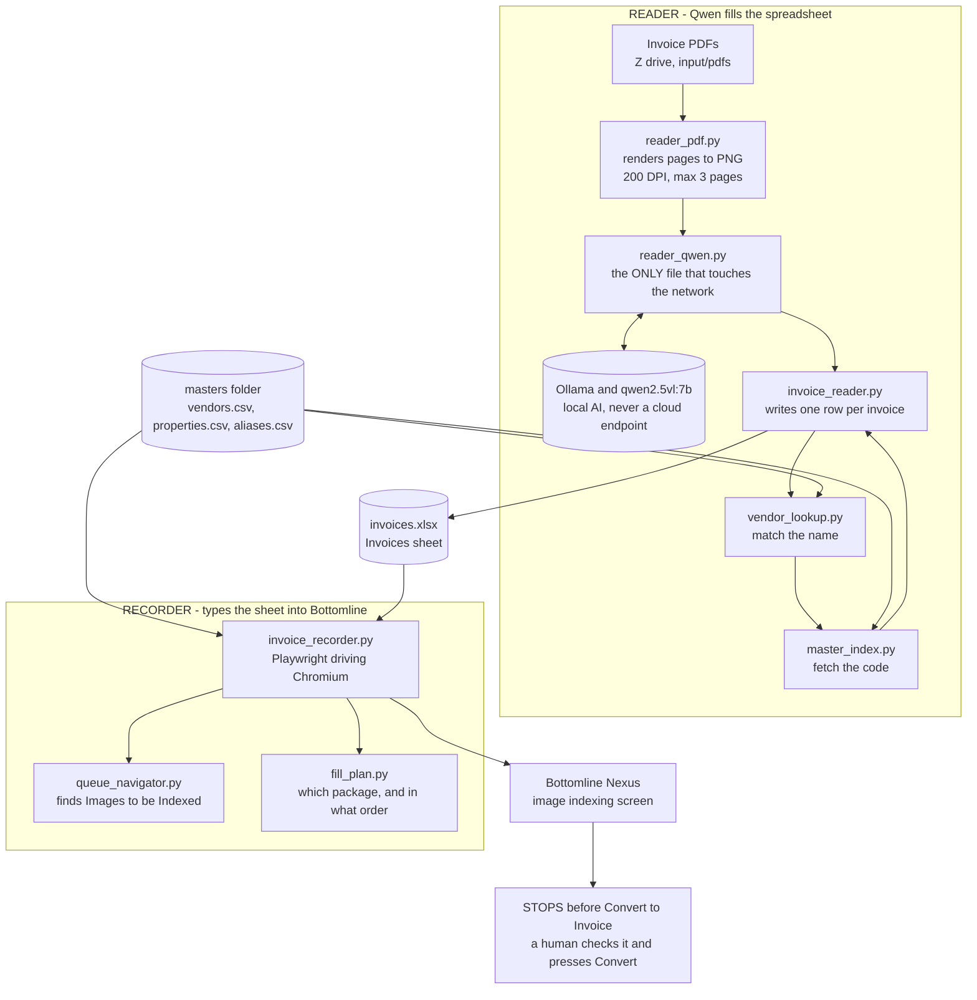
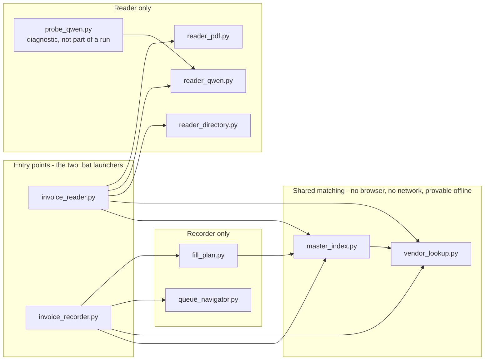
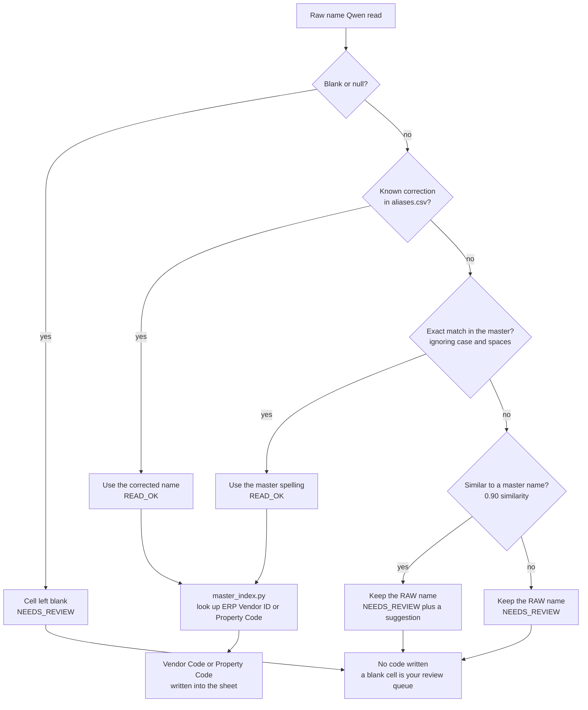
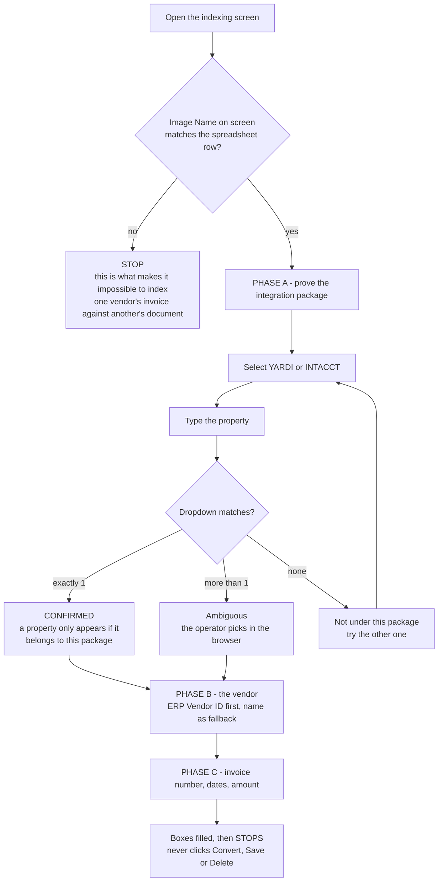

# Res-1

# Invoice Indexer — how it fits together

Four diagrams, for anyone picking this project up. No engineering background needed.
Every diagram is a Mermaid block: GitHub, VS Code (with a Mermaid extension) and
mermaid.live all render these as pictures rather than text.

---

## 1. End-to-end pipeline

The project is two halves that meet in the middle at one spreadsheet. The READER
turns PDFs into rows. The RECORDER types those rows into Bottomline and stops.

---

## 2. Module map — which file uses which

The middle box is the important one: that logic has no browser and no network, so it
can be proved correct on a laptop with the `selftest_*.py` scripts.

---

## 3. How a name becomes a code — the safety rule

A name is only ever **replaced** on a confident match, and never **erased** for failing
to match. An uncertain name can never drag a confident-looking code along with it.

---

## 4. Recorder phases — how the package is proved

The script never assumes an invoice belongs to Yardi or Intacct. It proves it: a
property only appears in the dropdown if it belongs to the package on screen, so that
dropdown is the test.

---

## Notes on accuracy (as of 2026-09-07)

- `probe_qwen.py` is a diagnostic tool, not part of a normal run.
- In Phase B the code-first path is wired for **vendors only**. The Property Code box
  is not connected yet, so properties are still searched by name.
- Property codes exist for **Yardi properties only** (16 of 152). Intacct properties
  have no code and are always matched by name — that is correct, not a gap.
